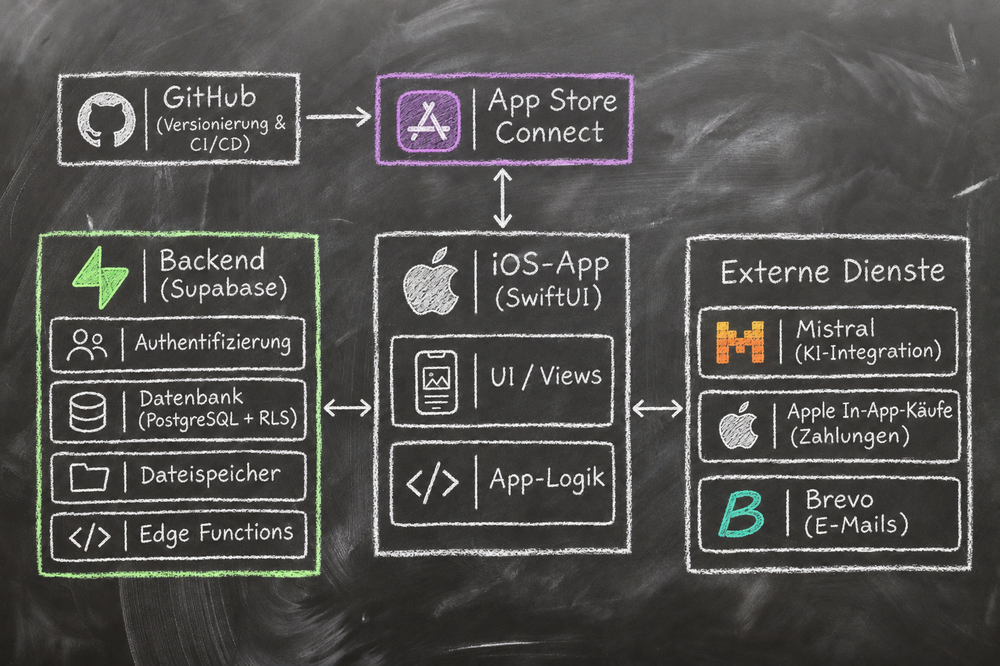
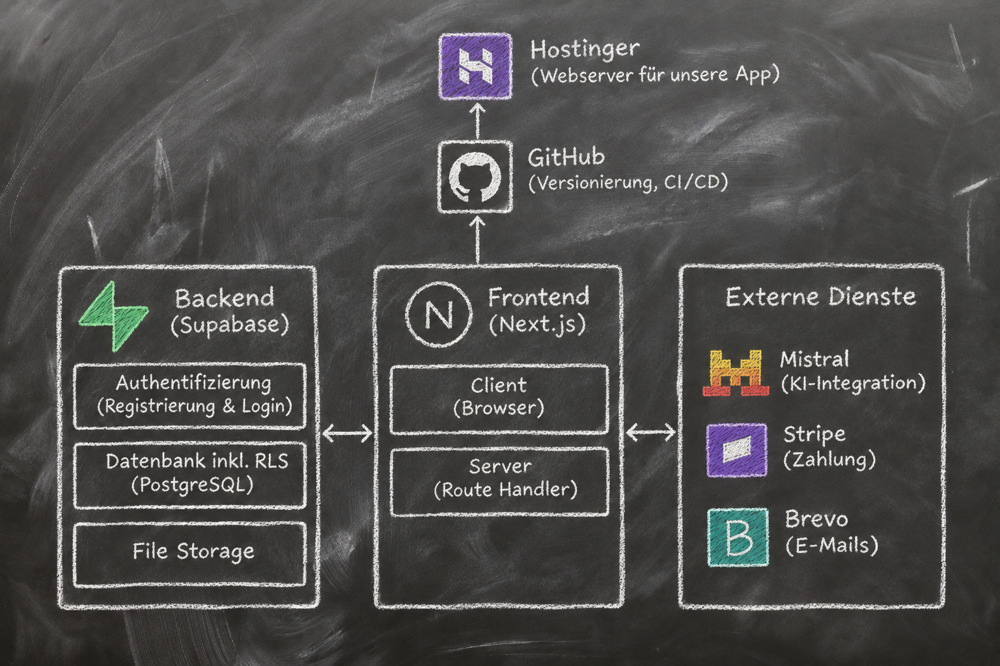

# Referenzarchitekturen für native Apple-Apps und Web-Apps

Dieses Kit unterstützt insbesondere native Apple-Anwendungen und Web-Apps. Die folgenden Diagramme und Beschreibungen sind grobe Referenzarchitekturen. Sie helfen, Anforderungen, Schnittstellen und Verantwortlichkeiten zu klären; sie schreiben einem Projekt keinen Anbieter oder Technologie-Stack vor. Maßgeblich sind die bestehende Codebasis und die Projektbeschreibung in `.codex/PROJECT.md`.

## Native Apple-App

Das Diagramm zeigt eine iOS-Referenz. Bei iPadOS- und macOS-Apps bleiben Backend- und Integrationsfragen relevant; UI, Navigation, Fenster- und Eingabeverhalten richten sich nach den jeweiligen Plattformen und den Projektkonventionen.

- **App:** native iOS-Anwendung mit SwiftUI; UI/Views und App-Logik bilden die Client-Seite.
- **Backend:** Supabase als Referenz für Authentifizierung, PostgreSQL mit Row Level Security (RLS), Dateispeicher und Edge Functions.
- **Externe Dienste:** beispielhaft Mistral für KI, Apple In-App Purchases für Zahlungen und Brevo für E-Mails.
- **Build und Veröffentlichung:** GitHub für Versionsverwaltung und CI/CD; App Store Connect für Builds, Testverteilung und Veröffentlichung.
- **Verbindungen:** Die App kommuniziert mit dem Backend und klar abgegrenzten externen Diensten. App Store Connect ist Teil des Veröffentlichungswegs.

## Web-App

- **Frontend:** Next.js oder Angular. Next.js kann Browser-Client und serverseitige Route Handler in einem Framework bereitstellen. Angular ist eine gleichwertige Frontend-Option; falls serverseitige Funktionen benötigt werden, werden sie als separate Backend- oder API-Komponente geplant.
- **Backend:** Supabase als Referenz für Registrierung und Login, PostgreSQL mit RLS sowie File Storage.
- **Externe Dienste:** beispielhaft Mistral für KI, Stripe für Zahlungen und Brevo für E-Mails.
- **Build und Veröffentlichung:** GitHub für Versionsverwaltung und CI/CD; Hostinger als dargestelltes Hosting-Ziel.
- **Verbindungen:** Browser und Server haben unterschiedliche Vertrauensgrenzen. Privilegierte Zugriffe und geheime Schlüssel gehören auf die Serverseite.

## Architektur bei Projektarbeit anwenden

1. Ermittle zuerst, ob das Projekt eine native Apple-App, eine Web-App oder eine Kombination daraus ist. Lies `.codex/PROJECT.md` und untersuche die vorhandene Architektur.
2. Nutze für jede betroffene Plattform die vier Bausteine in diesem Dokument: Spec-Vorgaben, Planvorgaben, Startkriterien und Abschlusskriterien.
3. Bewahre die Trennung zwischen UI, Anwendungslogik, Backend-Zugriff und externen Diensten. Passe die Trennung an die vorhandenen Muster des Projekts an.
4. Schütze Daten und Zugangsdaten: nutze serverseitige Geheimnisse, angemessene Autorisierung und Datenbankrichtlinien wie RLS, sofern die Architektur sie verwendet. Lege keine geheimen Schlüssel in Client-Code ab.
5. Behandle Anbieter in den Diagrammen als Beispiele. Übernimm sie nur, wenn sie im Projekt bereits eingesetzt oder ausdrücklich als Anforderung festgelegt sind.
6. Aktualisiere die Projektbeschreibung oder Architekturunterlagen, wenn eine Änderung Komponenten, Datenflüsse, Hosting, Integrationen oder Sicherheitsgrenzen wesentlich verändert.

## 1. Spec-Vorgaben

Vor der Planung beschreibt die Spec das gewünschte Verhalten und mindestens die für die Aufgabe relevanten Punkte:

- Zielplattform und betroffene Nutzer
- wichtige Nutzerabläufe, Zustände und beobachtbare Ergebnisse
- benötigte Berechtigungen und deren nutzerseitiger Zweck
- verarbeitete Daten, Speicherbedarf, Aufbewahrung und Löschung, soweit relevant
- externe Integrationen und erwartetes Verhalten bei Ausfall oder Fehlern
- Barrierefreiheitsanforderungen
- relevante Qualitätsziele wie Leistung, Zuverlässigkeit, Datenschutz, Sicherheit und Kompatibilität

Die Spec formuliert Anforderungen aus Nutzer- und Produktsicht. Frameworks, Laufzeit, Architekturpattern und konkrete Implementierung gehören in den Plan, außer eine technische Vorgabe ist ausdrücklich als Einschränkung gesetzt.

## 2. Plattformspezifische Planvorgaben

Der Plan untersucht die vorhandene Codebasis und hält relevante Entscheidungen, Begründungen und offene Punkte fest.

### Native Apple-App

Je nach Änderung berücksichtigen und dokumentieren:

- UI-Technologie und Deployment-Ziele für jede unterstützte Plattform und Mindestversion
- Navigation und Zustandsverwaltung
- plattformgerechte Layouts, Navigation und Eingabe (z. B. Touch auf iPhone, adaptive iPad-Oberflächen, Fenster, Menüs und Tastatur auf Mac)
- Persistenz und Backend-Zugriff
- Berechtigungen und verwendete Apple-Frameworks
- App-Lebenszyklus, Hintergrundverhalten und relevante Systemintegration
- Verifikationsschritte auf Build-, Simulator- oder Geräteebene

### Web-App

Je nach Änderung berücksichtigen und dokumentieren:

- Framework und Laufzeit, einschließlich Next.js oder Angular, falls zutreffend
- Rendering- und Routing-Modell
- Komponentenstruktur und Datenfluss
- APIs, Authentifizierung und Vertrauensgrenzen zwischen Browser, Server und Backend
- unterstützte Browser und Viewports
- Hosting- und Deployment-Ziel

## 3. Prüfkriterien vor der Umsetzung

Der Übergang von Plan zu Implementierung ist erst freigegeben, wenn die relevanten Punkte erfüllt oder als begründete, sichtbare Annahmen dokumentiert sind:

- Plattform und betroffene Architekturkomponenten sind identifiziert.
- Technische Architekturentscheidungen sind begründet und passen zu Projektbeschreibung und Codebasis.
- Datenflüsse, Vertrauensgrenzen, Berechtigungen und Integrationen sind verstanden.
- Wesentliche offene Entscheidungen sind geklärt oder mit Auswirkung als Annahmen markiert.
- Jedes Abnahmekriterium beschreibt ein prüfbares Ergebnis und ist im Plan durch Schritte und Nachweise abgedeckt.

## 4. Prüfkriterien zum Abschluss

Prüfe jedes Spec-Abnahmekriterium einzeln und ergänze für die betroffene Plattform die passenden Checks. Führe nur sinnvolle und im Projekt möglichen Checks aus. Weise nicht ausgeführte Checks und bekannte Einschränkungen ausdrücklich aus.

### Native Apple-App

- Build für das festgelegte Deployment-Ziel
- relevante Abläufe im Simulator oder auf einem Gerät
- Berechtigungs- und App-Lebenszyklusverhalten
- Accessibility für betroffene Abläufe und Oberflächen

### Web-App

- Build und passende automatisierte Tests
- zentrale Abläufe in unterstützten Browsern und Viewports
- Accessibility für betroffene Abläufe und Oberflächen
- Fehler- und Ladezustände sowie Sicherheitsgrenzen
